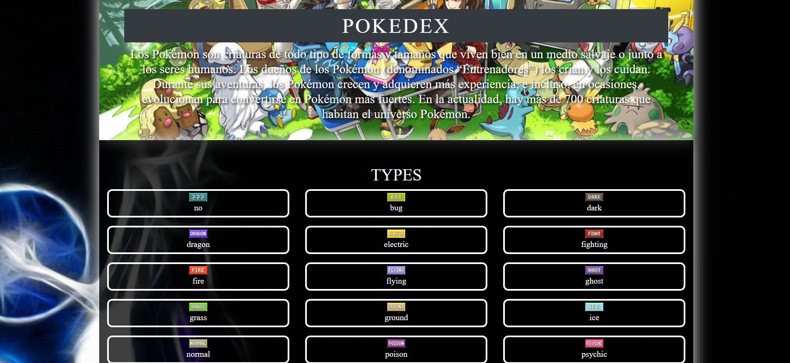
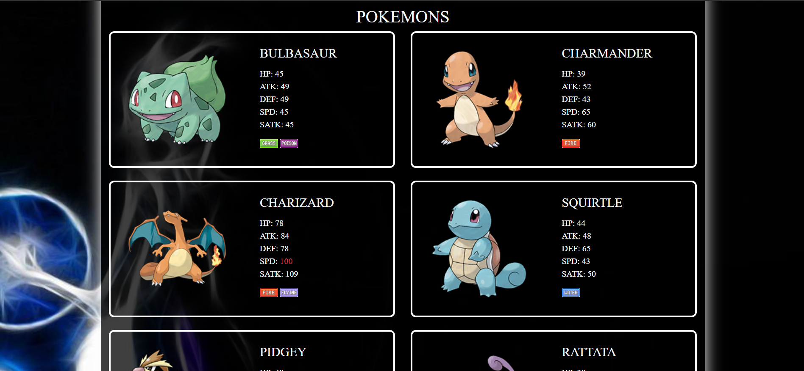

# ⚡ Pokédex — XML + XSLT Web Page

A Pokédex web page generated entirely from an **XML document** and transformed into HTML with **XSLT**. It lists every Pokémon type and a selection of **30 Pokémon** across several generations, with their official artwork, base stats and types.

> 🎓 **Academic project.** Built for the **Markup Languages and Information Management Systems** module (*Lenguajes de Marcas y Sistemas de Gestión de Información, LMSGI*) of the **Higher National Diploma in Multiplatform Application Development** (*CFGS Desarrollo de Aplicaciones Multiplataforma, DAM*), 1st year.

---

## 📸 Screenshots

| Header and types | Pokémon cards |
|---|---|
|  |  |

Speed stats above 99 are highlighted in red (see Charizard).

---

## ✨ Features

- **Data separated from presentation**: all content lives in `pokedex.xml`, and `style.xsl` turns it into a full HTML page in the browser.
- **Types section**: one card per type (18 in total), each with its icon.
- **Pokémon section**: 30 Pokémon from Bulbasaur to Zekrom, each with:
  - Official artwork, loaded from the Pokémon website using its Pokédex number.
  - Base stats: HP, ATK, DEF, SPD and SATK.
  - Type icons.
- **Conditional formatting** with `xsl:choose`: speed values above 99 are shown in red.
- **Responsive layout** with **Bootstrap 4** grid and cards.
- Custom background, header image and Poké Ball footer.
- **Pre-rendered `index.html`** preview that works in any browser, without XSLT.

---

## 🧰 Tech Stack

| Layer | Technology |
|---|---|
| Data | **XML** |
| Transformation | **XSLT 1.0** (`xsl:for-each`, `xsl:value-of`, `xsl:choose`, attribute value templates) |
| Presentation | HTML, CSS, Bootstrap 4 |
| Runtime | Web browser (client-side XSLT) |

---

## 🏗️ Architecture

```
pokedex.xml ──(xml-stylesheet)──▶ style.xsl ──▶ HTML page in the browser
                                      │
                                      └── style.css + img/ + Bootstrap
```

`pokedex.xml` links its stylesheet with:

```xml
<?xml-stylesheet href="style.xsl" type="text/xsl"?>
```

When the XML file is opened, the browser applies the XSLT and renders the generated HTML. Type icons are matched case-insensitively with `translate()`.

`index.html` is a static preview with 12 Pokémon, generated from the same XSLT. Some browsers are phasing out XSLT support, so this file keeps the page viewable everywhere.

### XML structure

```xml
<pokedex>
  <definition>…</definition>
  <types>
    <type>fire</type> …
  </types>
  <pokemon>
    <species>BULBASAUR</species>
    <dex>001</dex>
    <types><type>GRASS</type><type>POISON</type></types>
    <abilities><ability>OVERGROW</ability><dream>CHLOROPHYLL</dream></abilities>
    <baseStats><HP>45</HP><ATK>49</ATK><DEF>49</DEF><SPD>45</SPD><SATK>45</SATK><SDEF>65</SDEF></baseStats>
    <experience>64</experience>
    <rateType>MEDIUM SLOW</rateType>
  </pokemon>
  …
</pokedex>
```

---

## 📁 Project Structure

```
pokedex/
├── pokedex.xml      # Data: description, types and 30 Pokémon
├── style.xsl        # XSLT transformation to HTML
├── index.html       # Pre-rendered preview (12 Pokémon)
├── css/style.css    # Custom styles
├── img/             # Type icons, background, header, Poké Ball
└── screenshots/
```

---

## 🚀 Running Locally

### Quick preview
Open **`index.html`** directly in any browser (double-click). No server needed.

### Full XSLT version (30 Pokémon)
Browsers block XSLT on local files (`file://`), so `pokedex.xml` has to be served over HTTP:

1. Clone the repository:
   ```bash
   git clone https://github.com/ivangomezr/pokemon-pair-matching-game.git
   cd pokemon-pair-matching-game
   ```
2. Start a local server, for example with Python:
   ```bash
   python -m http.server 8000
   ```
   Or use the **Live Server** extension in VS Code.
3. Open `http://localhost:8000/pokedex.xml`.

> ℹ️ Pokémon artwork is loaded from `assets.pokemon.com`, so an internet connection is required.

---

## 🙋 Author

**Iván Gómez** — [@ivangomezr](https://github.com/ivangomezr)

Developed as coursework for the *Markup Languages and Information Management Systems* module, DAM.
